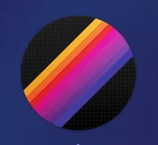
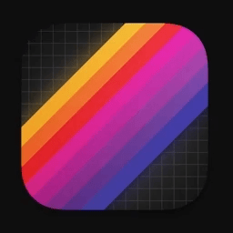
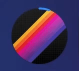
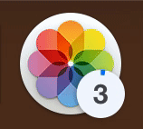
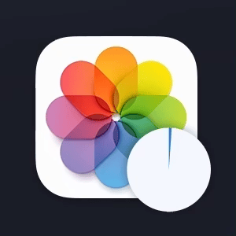

# DockProgress

> Show progress in your app's Dock icon

## Requirements

macOS 12+

## Install

Add `https://github.com/sindresorhus/DockProgress` in the [“Swift Package Manager” tab in Xcode](https://developer.apple.com/documentation/xcode/adding_package_dependencies_to_your_app).

*Latest version: 5.1.0*

## API

[See the API docs.](https://swiftpackageindex.com/sindresorhus/DockProgress/documentation/dockprogress/dockprogress)

## Usage

The snippets below are statements, so they must go inside a function (not at the top level of a file) and run on the main actor.

### Manually set the progress

```swift
foo.onUpdate = { progress in
	DockProgress.progress = progress
}
```

### Specify a [`Progress` instance](https://developer.apple.com/documentation/foundation/progress)

```swift
import Foundation
import DockProgress

let progress = Progress(totalUnitCount: 1)
progress.becomeCurrent(withPendingUnitCount: 1)

DockProgress.progressInstance = progress
```

The given `Progress` instance is weakly stored. It's up to you to retain it.

### Use in SwiftUI

```swift
import SwiftUI
import DockProgress

struct ContentView: View {
	@State private var progress = 0.0

	var body: some View {
		VStack {
			ProgressView(value: progress)
			Button("Start") {
				progress = 0.5
			}
		}
		.dockProgress(progress)
	}
}
```

Pass `nil` to reset the progress. By default, progress resets when the view disappears.

## Styles

Includes built-in styles (bar, squircle, circle, badge, pie) plus support for custom styles using SwiftUI views or Canvas drawing.

See the example app in the Xcode project for demonstrations.

Set the style once at launch. For example, in a SwiftUI app:

```swift
import SwiftUI
import DockProgress

@main
struct MyApp: App {
	init() {
		DockProgress.style = .squircle(color: .white.opacity(0.5))
	}

	var body: some Scene {
		WindowGroup {
			ContentView()
		}
	}
}
```

### Custom Styles

Create custom progress indicators with:

1. **SwiftUI View**: `.customView { progress in /* return any View */ }` - Maximum flexibility with any SwiftUI view
2. **SwiftUI Canvas**: `.customCanvas { context, size, progress in /* draw on canvas */ }` - High-performance custom drawing
3. **Legacy Core Graphics**: `.custom(drawHandler: (_ rect: CGRect) -> Void)` - Direct Core Graphics drawing (backward compatibility)

### Bar



```swift
DockProgress.style = .bar
```

This is the default.

### Squircle



```swift
DockProgress.style = .squircle(color: .white.opacity(0.5))
```

Fits perfectly around macOS app icons by default. Use the `inset` parameter for adjustments if needed.

### Circle



```swift
DockProgress.style = .circle(radius: 55, color: .blue)
```

### Badge



```swift
DockProgress.style = .badge(color: .blue, badgeValue: { getDownloadCount() })
```

Large numbers are shortened: `1012` → `1k`, `10000` → `9k+`.

**Note:** `badgeValue` is for counts (downloads, files, etc.), not percentages.

### Pie



```swift
DockProgress.style = .pie(color: .blue)
```

## Related

- [Defaults](https://github.com/sindresorhus/Defaults) - Swifty and modern UserDefaults
- [KeyboardShortcuts](https://github.com/sindresorhus/KeyboardShortcuts) - Add user-customizable global keyboard shortcuts to your macOS app
- [LaunchAtLogin](https://github.com/sindresorhus/LaunchAtLogin) - Add "Launch at Login" functionality to your macOS app
- [More…](https://github.com/search?q=user%3Asindresorhus+language%3Aswift+archived%3Afalse&type=repositories)
